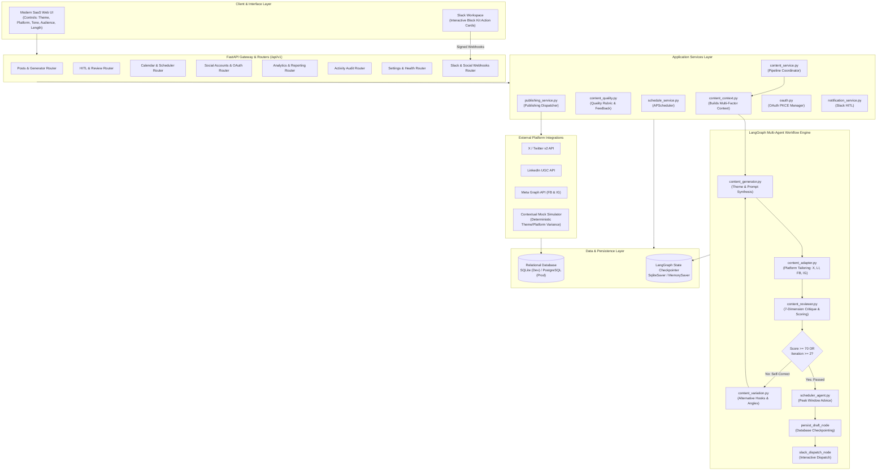
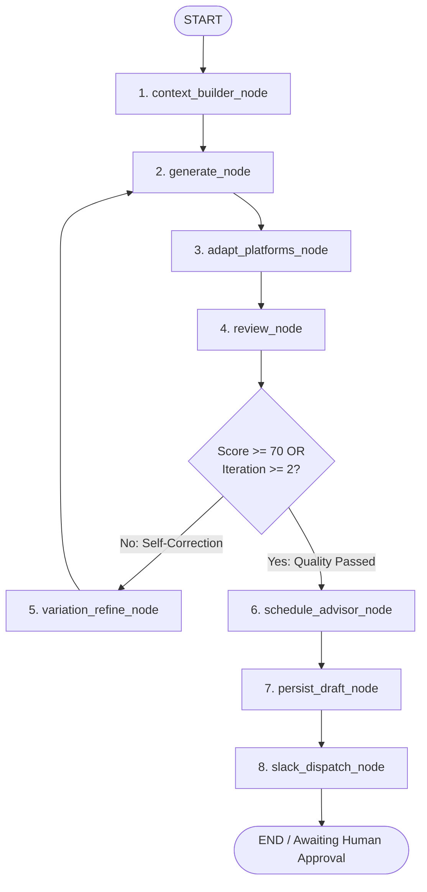

# AI Social Media Agent — Architecture & System Design Document

**Document Version:** 2.2  
**Project:** ICT Project 3 — AI Social Media Agent  
**Date:** October 2026  
**Status:** Approved Architecture with Intelligent AI Content Engine

---

## 1. Project Overview

The **AI Social Media Agent** is a **professional, production-oriented AI social media management platform suitable for an ICT project**. It is designed to automate the complete lifecycle of multi-platform digital content creation, intelligent variation, automated critique, and publishing while maintaining practical human oversight.

### 1.1 Core Mission
To provide a clean, reliable, and user-friendly platform that can:
1. **Intelligently Generate** original, grammatically sound, context-aware social content across major social networks (X/Twitter, LinkedIn, Facebook, and Instagram) using AI. The system interprets and expands the user's prompt rather than mechanically echoing it.
2. **Theme-Aware and Platform-Aware Adaptation**: Materially adapt style, vocabulary, hook, CTA, and structure based on chosen themes (*Thought Leadership, Product Launch, Storytelling, Educational, etc.*) and platforms.
3. **Genuine Variation on Regeneration**: Ensure regenerated content explores alternative hooks, structures, angles, and sentence patterns rather than repeating identical phrasing.
4. **Review & Score** content autonomously using an AI quality & policy critique agent evaluating grammar, topic relevance, theme adherence, platform suitability, naturalness, and CTA strength before human review.
5. **Self-Correct Automatically**: Iteratively refine content if the quality score is below the pass threshold ($\ge 70$), capped at 2 iterations to avoid infinite loops.
6. **Approve via Human-in-the-Loop (HITL)** with dual channels: a modern, interactive web dashboard and Slack Block Kit interactive message cards with verified action callbacks.
7. **Schedule** approved posts at peak audience engagement windows or user-selected calendar slots.
8. **Publish** reliably to supported social platform connectors with OAuth 2.0, token encryption at rest, automatic token refresh, and guaranteed idempotency. High-fidelity contextual mock publishing ensures the entire workflow functions out-of-the-box without requiring live third-party developer accounts.
9. **Track & Audit** publication history, delivery status, and authentic analytics metrics.

### 1.2 Core Workflow Pipeline
$$\text{Generation Context} \longrightarrow \text{AI Generator} \longrightarrow \text{AI Review \& Scoring} \xrightarrow[\text{Self-Correction}]{\text{Score } < 70\text{ \& Iter } < 2} \text{Regenerate / Refine}$$
$$\downarrow (\text{Score } \ge 70\text{ or Iter } \ge 2)$$
$$\text{Structured Output (Pydantic)} \longrightarrow \text{HITL Approval (Web / Slack)} \longrightarrow \text{APScheduler} \longrightarrow \text{Publishing (Live / Mock)} \longrightarrow \text{Audit Log}$$

---

## 2. Requirements & AI Content Intelligence Principles

### 2.1 Dynamic Content Generation (Not Echoing Input)
- **Input as Signal**: The user's prompt/topic is treated as a seed idea or core topic, never as the literal text output.
- **Contextual Synthesis**: Every generation request builds a rich `ContentGenerationContext` containing:
  - `topic`: Core subject or prompt provided by user.
  - `theme`: Content archetype (*Educational, Promotional, Thought Leadership, Storytelling, etc.*).
  - `platform`: Target network (*TWITTER, LINKEDIN, META_FACEBOOK, META_INSTAGRAM*).
  - `tone`: Voice persona (*Professional & Engaging, Visionary, Casual, Bold, etc.*).
  - `target_audience`: Demographic or professional segment (e.g. "Software Engineers", "Marketing Leaders", "Founders").
  - `content_type`: Format archetype (*Quick Insight, Case Study, Question Hook, Announcement, Carousel Guide*).
  - `desired_length`: Target length boundary (*Short, Medium, Long*).
  - `keywords`: Priority topical terms to integrate naturally.
  - `cta_preference`: Call-to-action directive (*Discussion, Link Click, Engagement, Save/Share*).
  - `previous_content`: Prior generation draft (if regenerating) to deliberately vary away from.

### 2.2 Theme-Aware Writing Engine
A theme is **never a decorative tag**; it fundamentally governs writing structure:
- **Educational**: Concept breakdown, bulleted takeaways, "How it works" structure, learning-oriented CTA.
- **Thought Leadership**: Contrarian or visionary perspective, industry trend context, strategic implications, high-level question CTA.
- **Product Launch / Announcement**: Excitement hook, value proposition, feature highlights, urgent CTA.
- **Storytelling**: Narrative arc (Challenge $\rightarrow$ Journey $\rightarrow$ Breakthrough $\rightarrow$ Lesson learned), emotional resonance.
- **Promotional**: Direct benefit framing, social proof, clear incentive, conversion CTA.
- **Inspirational**: Motivational hook, overcoming obstacles, empowering tone, uplifting closing.
- **Community / Engagement**: Open-ended conversational hook, relatable anecdote, active debate question prompt.

### 2.3 Platform-Aware Adaptation Engine
- **LinkedIn**: Thought leadership tone, professional spacing (double line breaks), 3 structured takeaways, industry hashtags, business CTA.
- **X / Twitter**: Hard 280-character ceiling, punchy one-sentence hook, conversational cadence, maximum 2–3 hashtags, emoji accents.
- **Instagram**: Visual narrative hook, scannable caption formatting, emotional/conversational tone, curated hashtag cluster, save/share CTA.
- **Facebook**: Community-centric voice, accessible explanation, conversational storytelling, engagement prompt.

### 2.4 Variation Engine on Regeneration
When the user requests "Regenerate" or when the self-correction loop triggers:
- The previous draft is provided to the generation context as a negative constraint ("Do not replicate previous structure, hook, or phrasing").
- The variation engine selects an alternative hook archetype (*Statistic Hook, Contrarian Statement, Anecdote, Question Hook, Analogy*).
- Structural syntax and sentence length distributions are intentionally varied.
- Alternative relevant hashtags and CTAs are substituted.

### 2.5 Multi-Dimensional Content Quality Review Rubric
The review agent critiques the generated draft across 7 distinct dimensions:
1. **Grammar & Mechanics**: Spelling, punctuation, sentence syntax, readability.
2. **Topic Relevance**: Does the content faithfully interpret and expand upon the requested topic?
3. **Theme Adherence**: Does the vocabulary, structure, and tone align with the selected theme?
4. **Platform Suitability**: Does the post obey platform character constraints and social conventions?
5. **Naturalness & Fluency**: Does the text read as authentic, human-crafted copy rather than generic robotic boilerplate?
6. **Originality & Variation**: Is the copy fresh, engaging, and distinct from previous iterations?
7. **CTA Quality**: Is the call-to-action organic, compelling, and relevant?
- **Scoring**: Composite score on a 0–100 scale. If Score $< 70$, actionable critique feedback is generated and passed to the self-correction node.

---

## 3. What We Are Improving from the Old Project

```
Old Project (Monolithic Prototype)
├── Simple string concatenation prompt: "Generate post for: {topic}"
├── Review agent was only hardcoded regex/heuristics (length & banned words)
├── Regenerating produced near-identical hardcoded mock text
├── Missing dedicated Analytics & Activity auditing
├── In-memory OAuth state (lost on restart)
└── Approvals restricted to Slack simulator tab
                            │
                            ▼
New Project Architecture (Intelligent & Modular)
├── Context-Aware Generation Engine (Theme, Platform, Tone, Audience, Length)
├── True Multi-Platform Adapters (Dedicated logic per social network)
├── Variation Engine: Explores alternative hooks, angles, and sentence patterns
├── 7-Dimension AI Reviewer: Grammar, Relevance, Theme, Platform, Naturalness, CTA
├── Cyclic LangGraph Self-Correction: Auto-refines drafts scoring below 70
├── Structured Pydantic Output: Full metadata attached to every generated post
├── Context-Aware Deterministic Mock Engine: Varies by topic, theme & platform
└── Zero Redis Dependency: Database-backed OAuth state and checkpointer
```

---

## 4. Proposed Technology Stack

| Layer | Technology | Rationale |
| :--- | :--- | :--- |
| **Backend Framework** | **FastAPI** (Python 3.10+) | High-performance async Python framework with automatic Swagger docs, Pydantic v2 validation, and clean dependency injection. |
| **Workflow Engine** | **LangGraph** | Industry standard for cyclic multi-agent graph orchestration, state management, conditional routing, and state checkpointing. |
| **LLM Orchestration** | **LangChain Core / Providers** | Standardized abstractions for LLM providers (Google Gemini, OpenAI, Anthropic) with deterministic contextual mock fallback. |
| **ORM & Database** | **SQLAlchemy 2.0** + **Alembic** | Reliable ORM supporting SQLite for local development and PostgreSQL for production. Alembic ensures clear schema migrations. |
| **Scheduler** | **APScheduler** | Robust task scheduling supporting interval checks, date triggers, and database-synced jobs. |
| **Security & Crypto** | **Cryptography (Fernet)** | Secure symmetric encryption of OAuth access/refresh tokens at rest without excessive complexity. |
| **HTTP Client** | **HTTPX** | Modern async HTTP client with timeouts for external platform and webhook requests. |
| **Frontend Architecture** | **Modular Vanilla JS (ES Modules) + HTML5 + CSS3 (Design Tokens)** | Zero-build, ultra-fast, dependency-free frontend with modular components (`/components/`, `/views/`). Avoids npm/bundler bloat while delivering modern SaaS aesthetics. |
| **Testing** | **Pytest** + **pytest-asyncio** | Async testing framework with fixtures and mock isolation. |
| **Containerization** | **Docker** & **Docker Compose** | Multi-container setup pairing the FastAPI backend with PostgreSQL 16. |

---

## 5. System Architecture & Workflow Pipeline



---

## 6. Folder Structure

The project structure cleanly separates generation intelligence, critique, services, and routing:

```
ai-social-media-agent/
├── backend/
│   ├── app/
│   │   ├── __init__.py
│   │   ├── main.py                     # Application entry point, lifespan, CORS, static mount
│   │   ├── config.py                   # Pydantic BaseSettings, environment validation
│   │   ├── routers/                    # Modular API endpoints
│   │   │   ├── __init__.py
│   │   │   ├── posts.py                # Create, list, retrieve, update, delete posts
│   │   │   ├── approvals.py            # HITL decisions, review history, pending queue
│   │   │   ├── calendar.py             # Scheduled events, calendar grid data, slot recommendations
│   │   │   ├── accounts.py             # Connected social accounts, credentials, OAuth initiate/callback
│   │   │   ├── analytics.py            # Aggregate metrics, platform distribution, success rates
│   │   │   ├── activity.py             # System activity logs, audit trail
│   │   │   ├── settings.py             # App configurations, mode toggles, API keys status
│   │   │   └── webhooks.py             # Inbound webhooks (Slack HMAC signature verification)
│   │   ├── agents/                     # Specialized AI agent implementations
│   │   │   ├── __init__.py
│   │   │   ├── content_generator.py    # Multi-model copy generation & theme synthesis
│   │   │   ├── content_reviewer.py     # 7-dimension critique, scoring & compliance
│   │   │   ├── content_adapter.py      # Platform-specific structural formatting
│   │   │   ├── content_variation.py    # Alternative hook, angle & phrasing engine
│   │   │   └── scheduler_agent.py     # Peak engagement window advisor
│   │   ├── graph/                      # LangGraph state machine orchestration
│   │   │   ├── __init__.py
│   │   │   ├── state.py                # TypedDict state schemas with full context
│   │   │   ├── nodes.py                # Execution nodes (generate, review, advise, persist, notify)
│   │   │   └── workflow.py             # StateGraph builder and compiled graph
│   │   ├── services/                   # Business logic layer
│   │   │   ├── __init__.py
│   │   │   ├── content_context.py      # Multi-factor context construction & prompt enrichment
│   │   │   ├── content_quality.py      # Quality rubric evaluator & scoring math
│   │   │   ├── content_service.py      # Pipeline runner & human decision coordinator
│   │   │   ├── publishing_service.py   # Multi-platform publishing & idempotency locks
│   │   │   ├── schedule_service.py     # APScheduler job manager & due-post worker
│   │   │   ├── notification_service.py # Slack Block Kit builder & notification dispatcher
│   │   │   └── analytics_service.py    # Metric aggregation & reporting computations
│   │   ├── database/                   # Database access layer
│   │   │   ├── __init__.py
│   │   │   ├── database.py             # Engine, SessionLocal, Base, init_db
│   │   │   ├── models.py               # Declarative SQLAlchemy models
│   │   │   └── crud.py                 # Reusable database queries & mutations
│   │   ├── integrations/               # External platform client connectors
│   │   │   ├── __init__.py
│   │   │   ├── base.py                 # Abstract BaseSocialPublisher
│   │   │   ├── x_api.py                # X (Twitter) v2 connector
│   │   │   ├── linkedin_api.py         # LinkedIn UGC share connector
│   │   │   ├── meta_api.py             # Facebook Pages & Instagram Graph connector
│   │   │   └── mock_publisher.py       # Deterministic contextual sandbox simulator
│   │   ├── auth/                       # Security & OAuth 2.0
│   │   │   ├── __init__.py
│   │   │   ├── security.py             # Fernet token encryption & helper functions
│   │   │   └── oauth.py                # Database-backed OAuth PKCE manager & state cache
│   │   └── schemas/                    # Pydantic request & response DTOs
│   │       ├── __init__.py
│   │       ├── post.py                 # Structured generation request and response schemas
│   │       ├── approval.py
│   │       ├── account.py
│   │       ├── analytics.py
│   │       └── settings.py
├── frontend/                           # Modern SaaS Web Interface
│   ├── index.html                      # Single-page shell with responsive layout
│   ├── css/
│   │   ├── tokens.css                  # Design tokens: colors, spacing, typography, shadows
│   │   ├── reset.css                   # Modern CSS reset & base normalization
│   │   ├── layout.css                  # Sidebar, header, content containers, responsive grid
│   │   ├── components.css              # Cards, buttons, badges, tables, modals, forms, toasts
│   │   └── views.css                   # Section-specific styles (Calendar, Studio, Analytics)
│   ├── js/
│   │   ├── app.js                      # Application root & router
│   │   ├── store.js                    # Reactive client state management
│   │   ├── api.js                      # Centralized Fetch API client with error handling
│   │   ├── components/                 # Reusable UI widgets
│   │   └── views/                      # 8 Main application views
├── migrations/                         # Alembic database migrations
├── tests/                              # Comprehensive test suite
├── docs/                               # Project documentation
├── .env.example                        # Template environment variables
├── requirements.txt                    # Python dependencies
└── run.py                              # Local development server launcher
```

---

## 7. UI/UX Architecture

The user interface exposes rich content controls rather than a basic text input:

### 7.1 Generator Studio Controls
- **Topic / Seed Idea**: Multi-line textarea for user theme or bulleted notes.
- **Theme Selector**: Dropdown featuring *Educational, Promotional, Inspirational, Informative, Thought Leadership, Product Launch, Announcement, Storytelling, Engagement, Community*.
- **Tone Selector**: *Professional & Engaging, Visionary, Casual & Conversational, Educational & Informative, Energetic & Bold*.
- **Target Audience Selector**: Predefined audience segments (*General, Tech & Developers, Business & Executives, Creators, Students*).
- **Content Type**: *Quick Insight, In-Depth Case Study, Question Hook, Carousel Concept*.
- **Length Preference**: *Short / Punchy, Medium / Standard, Long / Deep Dive*.
- **Quick-Refine Controls**:
  - `🔄 Regenerate with Variation` (explores alternative hooks and structure)
  - `✂️ Make Shorter` (condenses copy)
  - `📝 Make Longer` (expands with examples)
  - `🎣 Improve Hook` (swaps first line for a high-converting opening)
  - `📢 Add / Refine CTA` (optimizes the closing call-to-action)

### 7.2 The 8 Main Sections
1. **Dashboard**: High-level KPI cards, AI quality health indicator, recent activity stream.
2. **Create Content (Studio)**: Advanced generation controls, live multi-platform tabs, real-time character counters, AI review scorecard, and action buttons.
3. **Review / Approvals**: Review queue, copy inspection, inline editable textareas, approval actions (`Approve & Schedule`, `Publish Now`, `Reject / Redo`), and Slack Block Kit simulator.
4. **Content Calendar**: Interactive monthly calendar grid, scheduled post pills, and peak engagement slot advisor.
5. **Social Accounts**: Platform connection matrix with OAuth PKCE flows and sandbox toggles.
6. **Analytics & Metrics**: Publication success rate percentage, platform distribution, authentic data indicators, and CSV export.
7. **Activity & Audit Log**: Chronological audit trail with live search and expandable JSON details.
8. **Settings & Health**: System environment status, API key health checklist, and theme switches.

---

## 8. Design System & Tokens

*(Preserved standard tokens: typography, spacing scale 4/8/12/16/24/32/48px, dark/light theme variables, button styles, cards, and modal components).*

---

## 9. Database Design

*(Preserved 8 core tables: `posts`, `approval_requests`, `social_accounts`, `scheduled_posts`, `publish_logs`, `analytics_metrics`, `activity_logs`, `oauth_states`).*

---

## 10. API Architecture

API requests and responses for post generation return **Structured Output Schemas** rather than raw strings:

```python
class PostVariant(BaseModel):
    platform: str
    content: str
    character_count: int
    hashtags: List[str]
    call_to_action: Optional[str]
    hook_type: str

class GeneratePostResponse(BaseModel):
    post_id: int
    topic: str
    theme: str
    tone: str
    target_audience: str
    variants: Dict[str, PostVariant]
    review_score: int
    review_passed: bool
    review_feedback: str
    review_issues: List[str]
    generation_version: int
    recommended_time: Optional[str]
    status: str
```

---

## 11. AI Content Generation Intelligence Architecture

The AI layer is structured around specialized, decoupled agent modules:

```
                    ┌────────────────────────────────────────────────────────┐
                    │            content_context.py (Service)                │
                    │ - Constructs enriched prompt context from user input   │
                    │ - Encodes theme, tone, audience, length, and keywords  │
                    │ - Injects prior draft as negative constraint if varying│
                    └───────────────────────────┬────────────────────────────┘
                                                │
                                                ▼
                    ┌────────────────────────────────────────────────────────┐
                    │            content_generator.py (Agent)                │
                    │ - Synthesizes original concepts (never echoes topic)   │
                    │ - Orchestrates LLMs (Gemini / OpenAI / Claude)         │
                    │ - Contextual Deterministic Mock Fallback               │
                    └───────────────────────────┬────────────────────────────┘
                                                │
                                                ▼
                    ┌────────────────────────────────────────────────────────┐
                    │             content_adapter.py (Agent)                 │
                    │ - Tailors copy to X, LinkedIn, Facebook, and Instagram │
                    │ - Enforces platform spacing, formatting, and syntax    │
                    └───────────────────────────┬────────────────────────────┘
                                                │
                                                ▼
                    ┌────────────────────────────────────────────────────────┐
                    │             content_reviewer.py (Agent)                │
                    │ - Evaluates 7 quality dimensions                       │
                    │ - Computes 0-100 score + actionable critique feedback  │
                    └───────────────────────────┬────────────────────────────┘
                                                │
                                       ┌────────┴────────┐
                                       │ Score >= 70?    │
                                       └────────┬────────┘
                                      Yes       │ No & Iter < 2
                                       │        ▼
                                       │ ┌───────────────────────────┐
                                       │ │ content_variation.py      │
                                       │ │ - Selects alt hook archetype│
                                       │ │ - Varies angle & syntax   │
                                       │ └──────────────┬────────────┘
                                       │                │ Loops back to Gen
                                       ▼                ▼
                    ┌────────────────────────────────────────────────────────┐
                    │            scheduler_agent.py (Agent)                  │
                    │ - Recommends peak engagement window                    │
                    └────────────────────────────────────────────────────────┘
```

### 11.1 Agent Roles & Responsibilities

1. **`content_context.py` (Context Builder)**:
   - Takes raw user inputs and creates an enriched generation context.
   - Formulates distinct guidance for the chosen theme, audience, and content archetype.
2. **`content_generator.py` (Generator Agent)**:
   - Interprets the topic idea and produces rich, original copy.
   - Applies temperature and top-p sampling to ensure creativity.
   - Falls back to the **Contextual Deterministic Mock Engine** if external API keys are absent.
3. **`content_adapter.py` (Platform Adapter Agent)**:
   - Translates the core concept into network-native forms:
     - **LinkedIn**: Industry insight framing, professional white-space paragraphs, thought-provoking takeaways, business CTA.
     - **X (Twitter)**: High-impact opening hook under 280 chars, punchy rhythm, conversational cadence.
     - **Facebook**: Community-first, conversational storytelling, open-ended discussion question.
     - **Instagram**: Visual narrative opening, formatted caption with line breaks, curated hashtag block, save prompt.
4. **`content_variation.py` (Variation Engine)**:
   - When regenerating or self-correcting:
     - Analyzes the previous draft to identify its hook archetype (e.g. Question Hook).
     - Forces a different archetype (e.g. Contrarian Insight, Story Anecdote, Data/Stat Hook).
     - Restructures sentence syntax, switches active verbs, and modifies the closing CTA.
5. **`content_reviewer.py` (Critique & Reviewer Agent)**:
   - Evaluates the 7 core dimensions: Grammar, Topic Relevance, Theme Adherence, Platform Suitability, Naturalness, Originality, and CTA Quality.
   - Produces a composite score (0–100) and actionable issues list.
6. **`scheduler_agent.py` (Timing Optimization Agent)**:
   - Analyzes target platforms and computes the next peak engagement window.

---

## 12. LangGraph Workflow Architecture

The multi-agent execution pipeline uses **LangGraph** with cyclic self-correction:



- **Self-Correction Circuit Breaker**: Maximum 2 iterations to guarantee deterministic termination and prevent latency spikes.
- **State Checkpointing**: Uses `SqliteSaver` (or `MemorySaver` in tests) with unique `thread_id` per generation job.

---

## 13. Context-Aware Mock Generation Engine

Mock mode **never returns static hardcoded strings**. The mock engine synthesizes context-aware demo posts deterministically based on:
$$\text{Output} = f(\text{Topic}, \text{Theme}, \text{Platform}, \text{Tone}, \text{Audience}, \text{Variation Index})$$

- If the user selects theme `Educational` vs `Product Launch`, the mock output changes completely in structure, vocabulary, and call to action.
- If the user clicks `Regenerate`, the variation index increments, triggering an alternative hook and restructuring the post.
- Enables high-fidelity student demonstrations with zero external API dependencies.

---

## 14. OAuth & Security Architecture

- **Fernet Token Encryption**: OAuth access and refresh tokens are encrypted at rest using Fernet through Python's standard `cryptography` library.
- **Database-Backed OAuth States**: OAuth state parameters with PKCE verifiers are stored directly in `oauth_states` with a 10-minute TTL (no Redis required).
- **Slack HMAC-SHA256 Verification**: Inbound Slack actions are validated with anti-replay timestamp verification (300s).

---

## 15. Testing Strategy

Unit and integration tests validate the intelligent content engine:
- `test_content_context.py`: Verifies context enrichment across all 10 themes.
- `test_platform_adapter.py`: Verifies character limits and formatting for X, LinkedIn, FB, IG.
- `test_variation_engine.py`: Verifies that regenerating produces distinct hooks and wording ($>40\%$ lexical difference).
- `test_content_reviewer.py`: Verifies 7-dimension scoring and self-correction triggering when score < 70.
- `test_workflow_cycle.py`: Verifies LangGraph cyclic self-correction loop and checkpointing.

---

## 16. Development Phases

- **Phase 1: Architecture & Specification** *(Complete)*
- **Phase 2: Project Foundation, Database & Design System** *(Complete)*
- **Phase 3: Frontend Shell & Core UI/UX** *(Complete)*
- **Phase 4: Intelligent AI Agents & LangGraph Workflow** *(Upcoming: Generator, Theme Adapter, Variation Engine, Reviewer)*
- **Phase 5: Core Services, HITL & Scheduler**
- **Phase 6: REST API & Frontend Integration**
- **Phase 7: OAuth & Social Platform Integrations**
- **Phase 8: Analytics & Activity**
- **Phase 9: Testing, Security & Docker**
- **Phase 10: Documentation & Final Demo**

---

*End of Architecture Document.*
